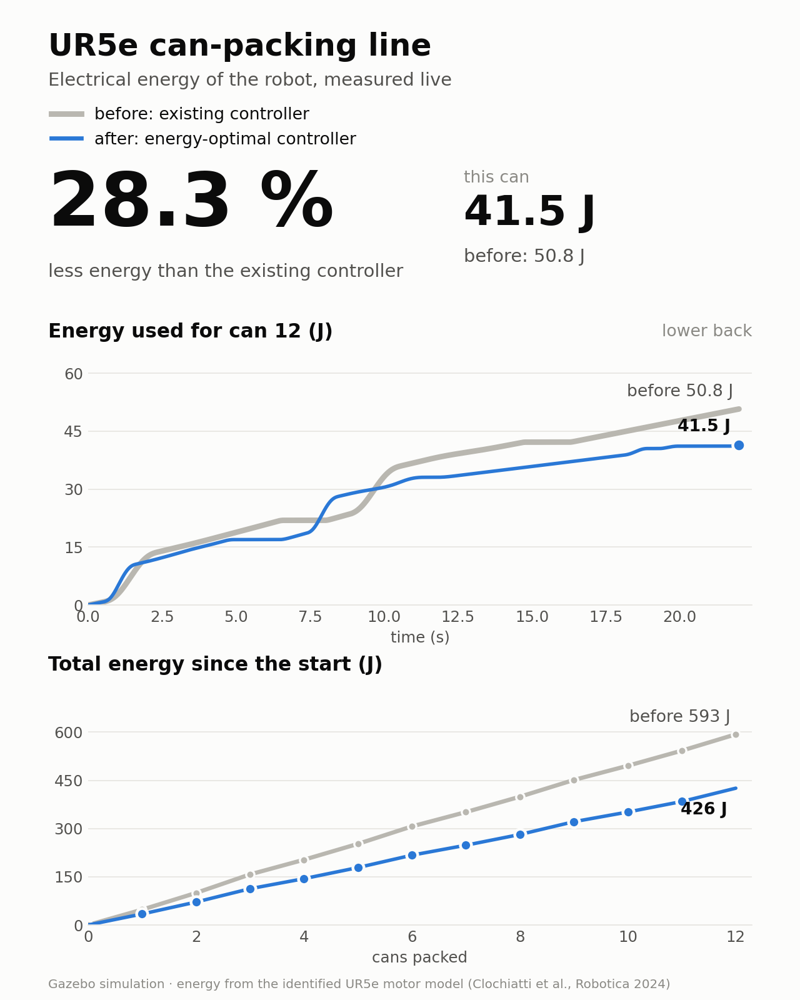

# Energy-optimal control of a UR5e for can packing

**−28.3 % electrical energy per carton** on a simulated UR5e can-packing line (ROS 2 Jazzy + Gazebo), with the same cans, the same 22 s rhythm, no faults, and the robot's own trajectory controller left unchanged.



By **Ahmed Hamouda** and **Zainab Almagbari**.

## The idea

A UR5e packs cans from a conveyor into a 3 × 4 carton, one can every 22 s. The existing approach (UR's `scaled_joint_trajectory_controller` following straight Cartesian paths) is fast, but it then waits, and the motors use energy even while holding still.

The new controller only replaces the **reference** that is sent to the same trajectory controller. For every carton slot it searches the shape and timing of the motion (lift height, move durations, via-points) for the lowest predicted electrical energy, subject to the same rules:

- the cycle fits in the 22 s rhythm, and the tool speed stays ≤ 0.20 m/s
- the can and gripper clear the table, the carton walls and the other cans by ≥ 1 cm
- lift and lower are vertical within 3 mm; placement error ≤ 5 mm
- joint torques stay within the UR5e limits

Energy comes from the identified UR5e motor model of Clochiatti et al., *Robotica* 42 (2024), Eq. 23, applied to the inverse-dynamics torque of the motion:

$$P_i = \frac{k_b}{k_t}\,\tau_i\dot q_i + \frac{\tau_i^2}{(N k_{m,i})^2}, \qquad E = \int \max\Big(0, \sum_i P_i\Big)\,dt$$

The search (a coarse grid plus Nelder–Mead refinement) runs in the background. Its result for each slot is saved in [`results/cans/learned.json`](results/cans/learned.json), so the robot is optimal from the first can.

## Results

Can-packing line, measured in Gazebo (cycle 1 not counted):

| | Existing controller | Energy-optimal controller | Change |
|---|---|---|---|
| Energy per carton (12 cans) | 593.3 J | 425.7 J | **−28.3 %** |
| Energy per can | 49.5 ± 4.0 J | 35.4 ± 3.9 J | −28.5 % |
| Peak power | 11.5 W | 13.7 W | +19 % |
| Cycle time | 22.0 s | 22.0 s | same |
| Max tool error | 3.0 mm | 4.0 mm | within limits |
| Faults | none | none | |

Full tables: [`results/cans/validation/summary.md`](results/cans/validation/summary.md). The first test of the two existing controllers on a simpler box task is in [`results/validation/summary.md`](results/validation/summary.md). The full write-up is in [`report/report.pdf`](report/report.pdf).

Gazebo's joint torques were checked against the gravity model built from the official UR5e mass data (within 0.07 N·m rms).

## Quick start

Ubuntu 24.04 with [ROS 2 Jazzy](https://docs.ros.org/en/jazzy/Installation.html).

```bash
sudo apt install ros-jazzy-ur ros-jazzy-ur-simulation-gz ros-jazzy-ros2-controllers

# the launch files use ~/ur5e_pp_ws, so clone it there
git clone https://github.com/<your-username>/ur5e-energy-optimal-control.git ~/ur5e_pp_ws
cd ~/ur5e_pp_ws
source /opt/ros/jazzy/setup.bash
colcon build --symlink-install
source install/setup.bash
```

**Replay the recorded result (no Gazebo):**
```bash
ros2 launch ur5e_pp_control demo.launch.py version:=after replay:=true replay_speed:=2.0
```

**Live demo in Gazebo:**
```bash
ros2 launch ur5e_pp_control demo.launch.py version:=before   # existing controller
ros2 launch ur5e_pp_control demo.launch.py version:=after    # energy-optimal controller
ros2 launch ur5e_pp_control demo.launch.py version:=after learned:=false   # watch it learn from scratch
```
Add `style:=video` for the large monitor shown above.

**Record a demo video** (Gazebo + live energy chart side by side, one carton, sped up to about 75 s, 1080p mp4; needs an X11 desktop and `sudo apt install ffmpeg wmctrl`):
```bash
~/ur5e_pp_ws/src/ur5e_pp_control/scripts/record_video.sh      # -> ~/ur5e_energy_demo.mp4
```

**Recompute the energy tables** from the recorded logs:
```bash
ros2 run ur5e_pp_control validate --dir ~/ur5e_pp_ws/results/cans
ros2 run ur5e_pp_control validate                     # box-task runs
```
The raw logs (q, q̇, τ and tool position at 100 Hz) are stored as `.csv.xz`. The tools read them directly; `unxz -k <file>` gives the plain CSV.

**Full energy test of the existing controllers** (box task, 30 cycles each, about 30 min, headless):
```bash
~/ur5e_pp_ws/src/ur5e_pp_control/scripts/run_tests.sh
```

## Repository layout

```
src/ur5e_pp_control/
├── ur5e_pp_control/
│   ├── energy_opt.py      the energy-optimal controller (path builder, cost, search)
│   ├── dynamics.py        UR5e inverse dynamics; the energy is computed from it
│   ├── kinematics.py      UR5e FK / Jacobian / IK (checked against the official URDF)
│   ├── trajectory.py      baseline pick → lift → transfer → place paths
│   ├── runner_node.py     runs the cycles, logs q, q̇, τ and tool error
│   ├── cans.py            can-packing cell layout (conveyor, carton, slots)
│   ├── energy_monitor.py  live / replay energy monitor
│   └── validate.py        energy model, tables and figures
├── launch/                sim, experiment and demo launch files
├── urdf/                  UR5e + 0.7 kg gripper with attach/detach
├── worlds/                box cell and can-packing cell
├── config/controllers.yaml
└── scripts/               run_tests.sh, record_video.sh
results/                   recorded runs (.json + .csv.xz) and validation tables/figures
report/                    report (PDF + LaTeX)
```

## Modelling notes

- **Gripper.** The 0.7 kg gripper is fixed to the flange. It grasps the 0.35 kg can through Gazebo's `DetachableJoint`, so the load is carried only between pick and place.
- **Torque.** Gazebo reports only the gravity part of the joint torque, so the energy uses the full inverse-dynamics torque τ = M(q)q̈ + C(q, q̇)q̇ + g(q) of the logged motion.
- **Limits.** Joint friction is zero in the simulation, so gear friction losses are not included. Braking energy is assumed not to be recovered.

## License

BSD-3-Clause, see [LICENSE](LICENSE).
